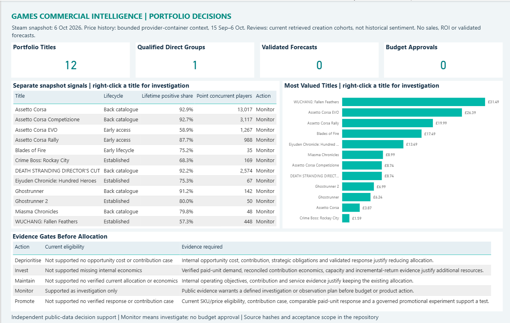

# Games Commercial Intelligence

**Which games need closer attention before changing prices or spending more on promotion?**

I analysed pricing, player feedback and player activity across 12 selected games published by 505 Games on Steam, with 20 other games providing market context. The aim was to help a commercial team decide where to investigate and what it would need to know before committing money.

The recommendation is to examine specific questions about the player experience and purchase expectations before changing promotional spend. Each game has its own follow-up questions and evidence needed for a decision.

[Read the case study](docs/Commercial%20case%20study.md) · [View the Power BI report](dashboard/README.md) · [Read the decision memo](docs/Commercial%20decision%20memo.md)

The executive overview brings together the headline observations and the information needed before changing spend. [Open the full-size image](docs/images/portfolio-overview.png) or [explore the five-page Power BI report](dashboard/README.md).

## How I approached the analysis

I collected UK prices, discount records, review information and counts of people playing. I checked missing information, inconsistent prices and whether the comparison games were sufficiently similar. Only Eiyuden Chronicle: Hundred Heroes had enough closely matched games for a direct group comparison.

I examined prices, review recommendations and player activity separately, then looked at selected examples from 3,572 collected review records to identify questions for product and support teams. I also worked through price-cut examples to show how many additional copies would need to sell to keep the total amount paid by customers unchanged, before costs.

The findings come together in a five-page Power BI report covering the games as a group, individual titles, pricing, player feedback and pricing scenarios.

## What I found

- **WUCHANG and Assetto Corsa EVO warrant closer product investigation.** About 57% and 59% of their counted Steam reviews were positive in the 6 October snapshot. Selected examples raised questions about combat in WUCHANG, and features, progress through the game and performance in EVO. These reports need checking against the current games and support evidence.
- **Eiyuden's lower price does not settle the commercial question.** At £13.49, it was below the middle price of £14.75 across its three closest comparison games, while its reviews were less positive. Player expectations and ease of use deserve investigation before assuming another discount is the answer.
- **Older titles deserve continued observation.** Assetto Corsa, Assetto Corsa Competizione and DEATH STRANDING DIRECTOR'S CUT had substantial numbers of people playing when the data was collected, alongside strong reviews overall. Repeated observations would help establish whether that interest lasts.

The [case study](docs/Commercial%20case%20study.md) explains the evidence behind these findings and the questions for all twelve games.

## What this means for a commercial team

The immediate actions are to check reported problems, understand player expectations and follow activity over time. Before changing prices or budgets, I would bring in actual sales, refunds, costs and campaign results, alongside product and support evidence. That would help assess whether an action could pay for itself and whether another use of the budget would be better.

The pricing examples make that discussion concrete: reducing a £10 price to £9 would require about 11.1% more copies sold to keep the total amount paid by customers the same, before costs. This gives the team a requirement to test against actual sales data.

## Scope and limits

The main comparison uses information collected on **6 October 2026**, with discount records covering **15 September–6 October** and detailed reviews collected on **7 October**.

Public information cannot establish actual sales, publisher profit or whether a promotion increased sales. Selected reviews cannot show how widespread a concern is. The recommendations identify what to investigate and what additional information would support a decision.

This is independent public-data analysis, with no affiliation to the publishers or platforms referenced.

## Explore the work

- [Commercial case study](docs/Commercial%20case%20study.md): the full findings and evidence behind each recommendation.
- [Decision memo](docs/Commercial%20decision%20memo.md): recommended actions and information needed before changing spend.
- [Power BI report](dashboard/README.md): how to open and use the report in Power BI Desktop.
- [Technical overview](docs/Technical%20overview.md): how Python, SQL and Power BI fit together, with links to detailed methods.
- [Reproduction guide](docs/Reproduction%20guide.md): how to run the analysis and check its results.
